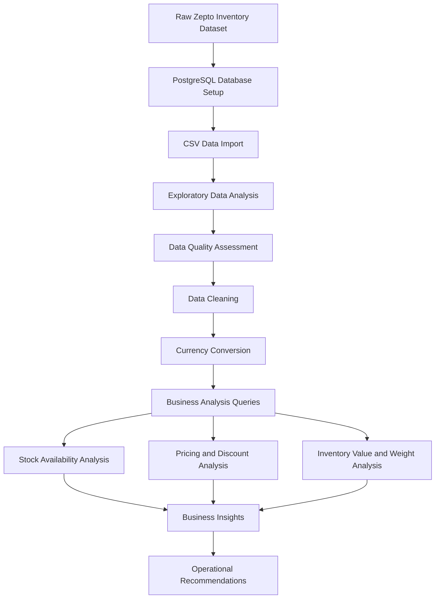

# Inventory & Supply Chain Analysis | PostgreSQL


## Project Overview

This project presents a SQL-based inventory and supply chain analysis using PostgreSQL and a Zepto e-commerce inventory dataset containing 3,732 product records.

The project investigates stock availability, product pricing, discount strategies, inventory retail value, product weight classifications and potential inventory management issues.

Through structured data exploration, SQL-based data cleaning and eight business-focused analytical queries, the project transforms inventory records into meaningful commercial and operational insights.

The objective is to support inventory monitoring, product pricing analysis, replenishment decisions and supply chain performance reporting.

## Executive Summary

| Key Performance Indicator | Result |
|---|---:|
| Original Inventory Records | 3,732 |
| Records Removed During Cleaning | 1 |
| Cleaned Inventory Records | 3,731 |
| Product Categories | 14 |
| Distinct Product Names | 1,680 |
| In-Stock Records | 3,278 |
| Out-of-Stock Records | 453 |
| Stockout Percentage | 12.14% |
| Stock Availability Percentage | 87.86% |
| Total Available Quantity | 14,959 |
| Estimated Inventory Retail Value | ₹2,243,080.60 |
| Total Available Inventory Weight | 6,005.85 kg |
| Highest Recorded Discount | 51% |

The analysis identifies opportunities to investigate stockouts, inventory concentration, product pricing and discount strategies.

The results were independently recalculated from the supplied CSV using the documented SQL cleaning rules.

Inventory retail value represents the potential selling value of available stock, not realised sales revenue or accounting inventory cost.

## Business Problem

E-commerce and quick-commerce businesses require reliable inventory information to maintain product availability, manage stock efficiently and develop appropriate pricing strategies.

Without structured inventory reporting, management may struggle to:

- Identify unavailable products.
- Monitor stock availability across product categories.
- Evaluate potential inventory retail value.
- Identify products offering significant discounts.
- Investigate high-value products that are out of stock.
- Compare product prices across different package weights.
- Understand inventory concentration.
- Identify potential data quality issues.
- Support inventory replenishment and operational planning.

This project addresses these requirements through a structured PostgreSQL analytical solution.

## Project Objectives

- Create a structured PostgreSQL inventory database.
- Explore and validate the source dataset.
- Identify missing values and invalid product prices.
- Investigate repeated product names.
- Convert monetary values from paise to Indian rupees.
- Analyse stock availability and stockout patterns.
- Identify products with the highest discount percentages.
- Evaluate high-value products that are unavailable.
- Estimate available inventory retail value by category.
- Compare average discounts across product categories.
- Calculate product price per gram.
- Classify products according to weight.
- Calculate total inventory weight by category.
- Translate analytical findings into potential business recommendations.

## Tools and Technologies

| Tool / Technique | Application |
|---|---|
| PostgreSQL | Relational database and analytical processing |
| SQL | Data exploration, cleaning and analysis |
| pgAdmin | Database administration and query execution |
| CREATE TABLE | Database table development |
| Primary Keys | Unique database row identification |
| SELECT and WHERE | Data retrieval and conditional filtering |
| DISTINCT | Identification of distinct result combinations |
| GROUP BY | Category-level aggregation |
| HAVING | Filtering aggregated results |
| COUNT | Inventory record analysis |
| SUM | Inventory value and weight calculations |
| AVG | Average discount analysis |
| ROUND | Numerical presentation |
| CASE WHEN | Product weight classification |
| ORDER BY and LIMIT | Ranked product and category analysis |
| UPDATE and DELETE | Data cleaning and transformation |
| CSV | Source inventory data |
| GitHub | Project documentation and version control |

## Dataset Overview

The project uses a Zepto e-commerce inventory dataset containing product listings, pricing information, stock availability and product weight information.

### Dataset Characteristics

| Characteristic | Description |
|---|---|
| Original Records | 3,732 |
| Original Columns | 9 |
| Product Categories | 14 |
| Distinct Product Names After Cleaning | 1,680 |
| Source Format | CSV |
| Original Monetary Units | Indian paise |
| Analytical Monetary Units | Indian rupees (INR) |
| Data Granularity | Product inventory records |

### Data Dictionary

| Column | Data Type | Description |
|---|---|---|
| sku_id | SERIAL | Generated database row identifier |
| category | VARCHAR | Product category |
| name | VARCHAR | Product name |
| mrp | NUMERIC | Maximum Retail Price |
| discountPercent | NUMERIC | Recorded discount percentage |
| availableQuantity | INTEGER | Available inventory quantity |
| discountedSellingPrice | NUMERIC | Selling price after discount |
| weightInGms | INTEGER | Recorded product weight in grams |
| outOfStock | BOOLEAN | Product stock availability status |
| quantity | INTEGER | Additional source quantity attribute |

The sku_id field is generated during database creation and is not present in the original CSV.

It identifies individual database rows and should not be interpreted as a verified original retailer SKU identifier.

The precise business definition of the additional quantity field has not been independently confirmed.

## Database Design

The inventory dataset is imported into a PostgreSQL table named zepto.

```sql
CREATE TABLE IF NOT EXISTS zepto (
    sku_id SERIAL PRIMARY KEY,
    category VARCHAR(120),
    name VARCHAR(150) NOT NULL,
    mrp NUMERIC(8, 2),
    discountPercent NUMERIC(5, 2),
    availableQuantity INTEGER,
    discountedSellingPrice NUMERIC(8, 2),
    weightInGms INTEGER,
    outOfStock BOOLEAN,
    quantity INTEGER
);
```

Appropriate database data types support numerical calculations, logical stock filtering and product-level analysis.

The generated primary key ensures that each imported inventory record can be identified individually.

The database setup script is available here:

[Database_Setup.sql](Database_Setup.sql)

## Analytical Workflow



## Exploratory Data Analysis

Before conducting the main business analysis, several SQL queries were used to understand the dataset's structure and quality.

### 1. Total Inventory Record Count

```sql
SELECT COUNT(*)
FROM zepto;
```

**Result:** 3,732 original inventory records.

### 2. Sample Data Inspection

```sql
SELECT *
FROM zepto
LIMIT 10;
```

This query supports initial inspection of product descriptions, price values, stock quantities and inventory classifications.

### 3. Missing Value Assessment

```sql
SELECT *
FROM zepto
WHERE name IS NULL
   OR category IS NULL
   OR mrp IS NULL
   OR discountPercent IS NULL
   OR discountedSellingPrice IS NULL
   OR weightInGms IS NULL
   OR availableQuantity IS NULL
   OR outOfStock IS NULL
   OR quantity IS NULL;
```

Independent inspection of the supplied CSV found no missing values across the nine source columns.

### 4. Product Category Exploration

```sql
SELECT DISTINCT category
FROM zepto
ORDER BY category;
```

**Result:** 14 distinct product categories.

### 5. Stock Availability Analysis

```sql
SELECT
    outOfStock,
    COUNT(sku_id)
FROM zepto
GROUP BY outOfStock;
```

This query provides an initial comparison between available and unavailable inventory records.

### 6. Repeated Product Name Analysis

```sql
SELECT
    name,
    COUNT(sku_id) AS number_of_skus
FROM zepto
GROUP BY name
HAVING COUNT(sku_id) > 1
ORDER BY COUNT(sku_id) DESC;
```

The dataset contains repeated product names.

Repeated names may represent different product variants, package sizes, category assignments or duplicated records.

Consequently, repeated names should not automatically be deleted without establishing the correct product-level identifier.

## Data Cleaning

### 1. Invalid Product Pricing

Products with zero maximum retail prices or discounted selling prices were investigated.

```sql
SELECT *
FROM zepto
WHERE mrp = 0
   OR discountedSellingPrice = 0;
```

The cleaning process removes records with a zero maximum retail price.

```sql
DELETE FROM zepto
WHERE mrp = 0;
```

| Cleaning Stage | Record Count |
|---|---:|
| Original Dataset | 3,732 |
| Removed Records | 1 |
| Cleaned Dataset | 3,731 |

After removing the zero-MRP record, no remaining records have a zero discounted selling price.

### 2. Monetary Unit Conversion

The source prices are recorded in paise.

To support clearer commercial interpretation, monetary values are converted into Indian rupees.

```sql
UPDATE zepto
SET
    mrp = mrp / 100.0,
    discountedSellingPrice =
        discountedSellingPrice / 100.0;
```

For example:

- 4,500 paise becomes ₹45.
- 27,500 paise becomes ₹275.

This transformation improves the interpretability of subsequent pricing and inventory valuation calculations.

The currency conversion should only be executed once per fresh import.

Running the same UPDATE statement repeatedly would incorrectly reduce the monetary values.

## SQL Business Analysis

The project contains eight core business-focused analytical queries.

The complete analysis is available here:

[Inventory_Analysis.sql](Inventory_Analysis.sql)

| Query | Business Question | SQL Techniques |
|---:|---|---|
| 1 | Which products offer the highest discounts? | DISTINCT, ORDER BY, LIMIT |
| 2 | Which high-value products are out of stock? | WHERE, Boolean Filtering |
| 3 | What is the inventory retail value by category? | SUM, GROUP BY |
| 4 | Which expensive products offer relatively low discounts? | Conditional Filtering |
| 5 | Which categories offer the highest average discounts? | AVG, ROUND, GROUP BY |
| 6 | Which products offer the lowest selling price per gram? | Arithmetic Calculations, ROUND |
| 7 | How can products be classified by weight? | CASE WHEN |
| 8 | What is the total available inventory weight by category? | SUM, Multiplication, GROUP BY |

### Query 1 — Products With the Highest Discounts

```sql
SELECT DISTINCT
    name,
    mrp,
    discountPercent
FROM zepto
ORDER BY discountPercent DESC
LIMIT 10;
```

This query identifies products offering the highest recorded percentage discounts.

Discount percentage is used as an indicator of promotional intensity rather than an independent measure of overall product value.

### Query 2 — High-Value Out-of-Stock Products

```sql
SELECT DISTINCT
    name,
    mrp
FROM zepto
WHERE outOfStock = TRUE
  AND mrp > 300
ORDER BY mrp DESC;
```

This query identifies unavailable products with a maximum retail price exceeding ₹300.

These products may warrant further inventory investigation, although selling price alone does not establish replenishment priority.

### Query 3 — Estimated Inventory Retail Value by Category

```sql
SELECT
    category,
    SUM(
        discountedSellingPrice * availableQuantity
    ) AS inventory_retail_value
FROM zepto
GROUP BY category
ORDER BY inventory_retail_value DESC;
```

The calculation estimates the potential retail selling value of currently available inventory.

Inventory Retail Value =
Discounted Selling Price × Available Quantity

This is not realised sales revenue, profit or inventory acquisition cost.

### Query 4 — High-Priced Products With Low Discounts

```sql
SELECT DISTINCT
    name,
    mrp,
    discountPercent
FROM zepto
WHERE mrp > 500
  AND discountPercent < 10
ORDER BY mrp DESC, discountPercent DESC;
```

This query identifies products with maximum retail prices above ₹500 and discounts below 10%.

The results support further investigation of premium product pricing and discount strategies.

### Query 5 — Categories With the Highest Average Discounts

```sql
SELECT
    category,
    ROUND(AVG(discountPercent), 2) AS avg_discount
FROM zepto
GROUP BY category
ORDER BY avg_discount DESC
LIMIT 5;
```

This query compares average recorded discounts across product categories.

The calculation uses an unweighted average across inventory records.

It does not account for sales volumes or product revenue.

### Query 6 — Product Price per Gram

```sql
SELECT DISTINCT
    name,
    weightInGms,
    discountedSellingPrice,
    ROUND(
        discountedSellingPrice / weightInGms,
        2
    ) AS price_per_gram
FROM zepto
WHERE weightInGms >= 100
ORDER BY price_per_gram;
```

Price per gram provides a standardised pricing metric across products of different package weights.

Comparisons are most meaningful between similar products because different product types may have significantly different underlying costs and characteristics.

### Query 7 — Product Weight Classification

```sql
SELECT DISTINCT
    name,
    weightInGms,
    CASE
        WHEN weightInGms < 1000 THEN 'Low'
        WHEN weightInGms < 5000 THEN 'Medium'
        ELSE 'Bulk'
    END AS weight_category
FROM zepto;
```

Products are classified into three weight groups.

| Weight Classification | Criteria |
|---|---|
| Low | Below 1,000 grams |
| Medium | 1,000 to below 5,000 grams |
| Bulk | 5,000 grams or above |

Weight classification can support further investigation of product handling, storage and fulfilment requirements.

These thresholds are analytical classifications rather than established supply chain industry standards.

### Query 8 — Total Inventory Weight by Category

```sql
SELECT
    category,
    SUM(
        weightInGms * availableQuantity
    ) AS total_weight
FROM zepto
GROUP BY category
ORDER BY total_weight;
```

This calculation estimates the combined weight of available stock across product categories.

Total Inventory Weight =
Product Weight × Available Quantity

The result provides a starting point for investigating inventory handling and storage requirements.

## Key Analytical Findings

### 1. Overall Stock Availability

| Stock Status | Records | Percentage |
|---|---:|---:|
| In Stock | 3,278 | 87.86% |
| Out of Stock | 453 | 12.14% |
| Total | 3,731 | 100.00% |

Approximately 12.14% of cleaned inventory records are classified as out of stock.

Independent data validation also found that the recorded stock status agrees with whether the available quantity is zero.

**Business implication:** Inventory teams could investigate unavailable products and monitor stock availability through recurring exception reports.

Stockout counts should be supplemented with sales demand and supplier lead-time information before prioritising replenishment.

### 2. Inventory Availability by Category

| Category | Records | Out-of-Stock Records | Stockout Rate |
|---|---:|---:|---:|
| Biscuits | 147 | 42 | 28.57% |
| Dairy, Bread & Batter | 129 | 28 | 21.71% |
| Beverages | 129 | 28 | 21.71% |
| Meats, Fish & Eggs | 63 | 12 | 19.05% |
| Health & Hygiene | 97 | 13 | 13.40% |
| Cooking Essentials | 514 | 64 | 12.45% |
| Munchies | 514 | 64 | 12.45% |

Biscuits records the highest stockout rate among the categories in the dataset.

Cooking Essentials and Munchies contain the largest absolute numbers of unavailable records.

This demonstrates the importance of distinguishing absolute stockout counts from percentage-based stock availability.

**Business implication:** Management should monitor both the number and proportion of unavailable inventory records to identify categories requiring further investigation.

### 3. Estimated Available Inventory Retail Value

The cleaned dataset contains 14,959 available inventory units with an estimated aggregate retail selling value of ₹2,243,080.60.

| Category | Estimated Retail Value |
|---|---:|
| Cooking Essentials | ₹337,369.00 |
| Munchies | ₹337,369.00 |
| Paan Corner | ₹270,849.00 |
| Personal Care | ₹270,849.00 |
| Ice Cream & Desserts | ₹224,385.00 |
| Chocolates & Candies | ₹224,385.00 |
| Packaged Food | ₹224,385.00 |
| Home & Cleaning | ₹122,661.00 |
| Health & Hygiene | ₹64,180.00 |
| Dairy, Bread & Batter | ₹55,051.00 |
| Beverages | ₹55,051.00 |
| Biscuits | ₹25,007.60 |
| Meats, Fish & Eggs | ₹20,693.00 |
| Fruits & Vegetables | ₹10,846.00 |
| Total | ₹2,243,080.60 |

Cooking Essentials and Munchies record the joint-highest estimated inventory retail value.

However, identical category-level totals across several groups indicate potential repeated inventory patterns that require further investigation.

**Business implication:** The calculated figures can support exploratory inventory valuation, but category assignments and possible overlapping records should be reconciled before using the results for financial decisions.

### 4. Highest Product Discount Percentages

The highest recorded discount percentage is 51%.

| Product | MRP | Discount |
|---|---:|---:|
| Dukes Waffy Chocolate Wafers | ₹45 | 51% |
| Dukes Waffy Orange Wafers | ₹45 | 51% |
| Dukes Waffy Strawberry Wafers | ₹45 | 51% |
| RRO Fresh Ricotta | ₹275 | 50% |
| RRO Cheddar Block Cheese | ₹295 | 50% |

Several additional products also record discounts of 50%.

The SQL query does not include a secondary tie-breaking criterion, so the ordering of products with identical discount percentages may vary.

**Business implication:** Commercial teams could investigate whether substantial discounts are associated with promotional campaigns, product expiry considerations or inventory clearance.

The dataset does not establish the underlying reasons for individual discounts.

### 5. Average Discount by Product Category

| Category | Average Discount |
|---|---:|
| Fruits & Vegetables | 15.46% |
| Meats, Fish & Eggs | 11.03% |
| Ice Cream & Desserts | 8.32% |
| Chocolates & Candies | 8.32% |
| Packaged Food | 8.32% |

Fruits & Vegetables records the highest average discount percentage.

The results indicate variation in recorded discount strategies across product categories.

**Business implication:** Management could investigate category-specific pricing strategies while considering product shelf life, procurement costs, competitor prices and customer demand.

The dataset does not independently establish the profitability or effectiveness of these discounts.

### 6. Total Available Inventory Weight

The combined recorded weight of available inventory is:

| Measurement | Result |
|---|---:|
| Total Inventory Weight in Grams | 6,005,849 |
| Total Inventory Weight in Kilograms | 6,005.85 |
| Approximate Weight in Metric Tonnes | 6.01 |

Inventory weight can provide useful operational information when investigating storage, transportation and fulfilment requirements.

However, weight alone does not establish storage volume, handling difficulty or transport cost.

**Business implication:** Inventory teams could combine product weight with package dimensions, storage requirements and fulfilment information to improve operational planning.

### 7. Repeated Product and Category Patterns

The cleaned dataset contains 3,731 inventory records but only 1,680 distinct product names.

Several product categories also contain identical aggregate record counts, stockout counts, average discounts and estimated inventory retail values.

Examples include:

- Cooking Essentials and Munchies.
- Paan Corner and Personal Care.
- Ice Cream & Desserts, Chocolates & Candies and Packaged Food.
- Dairy, Bread & Batter and Beverages.

These patterns warrant further investigation into possible repeated listings, overlapping category assignments or source-data construction.

They should not automatically be treated as confirmed duplicates.

**Business implication:** A verified original SKU identifier and clearer category assignment rules would improve inventory reporting reliability.

## Additional Data Validation

| Validation Check | Result |
|---|---|
| Missing Source Values | None identified |
| Zero-MRP Records | 1 |
| Records After Cleaning | 3,731 |
| Remaining Zero Selling Prices | 0 |
| Stock Status and Zero Quantity Agreement | Passed |
| Repeated Product Names | Identified |
| Identical Category-Level Aggregates | Identified |
| Original Retailer SKU Identifier | Not available |

These checks demonstrate the importance of validating source data before interpreting commercial results.

## Business Recommendations

| Analytical Finding | Recommended Action | Potential Business Benefit |
|---|---|---|
| 12.14% of records are out of stock | Develop regular stock availability exception reports | Improved inventory visibility |
| Biscuits records a relatively high stockout rate | Investigate product demand and replenishment requirements | Potential reduction in unavailable products |
| High-value products are out of stock | Evaluate sales demand and supplier lead times | More informed replenishment prioritisation |
| Inventory retail value exceeds ₹2.24M | Monitor inventory concentration and reconcile product records | Improved inventory reporting |
| Some products receive discounts of 51% | Investigate promotion effectiveness and product margins | Better-informed pricing decisions |
| Discount percentages vary by category | Review category-specific pricing policies | Improved commercial planning |
| Product prices vary by package weight | Compare unit prices within similar product groups | More meaningful product value assessments |
| Available inventory weighs approximately 6 tonnes | Investigate storage and handling requirements | Improved operational planning |
| Repeated category-level patterns exist | Validate product identifiers and category assignments | More reliable inventory reporting |

These recommendations represent potential business actions derived from the analysis rather than implemented operational changes or confirmed financial improvements.

## Practical Business Applications

### Inventory Management

- Monitoring stock availability.
- Identifying unavailable products.
- Investigating category-level stockout patterns.
- Supporting replenishment prioritisation.

### Supply Chain Analysis

- Investigating inventory weight.
- Supporting further warehouse capacity analysis.
- Evaluating stock concentration.
- Establishing a foundation for supplier and replenishment analysis.

### Commercial Analysis

- Investigating product pricing.
- Comparing discount strategies.
- Evaluating product value through unit pricing.
- Estimating inventory retail selling value.

### Management Information Reporting

- Developing reusable SQL reporting queries.
- Producing inventory performance metrics.
- Identifying data quality exceptions.
- Supporting structured management decision-making.

## Analytical Limitations

- The dataset represents an inventory snapshot rather than a complete historical inventory record.
- The precise collection date has not been independently confirmed.
- Original retailer SKU identifiers are unavailable.
- Generated database identifiers represent rows rather than verified unique products.
- Repeated product names may represent different product variants or overlapping listings.
- Identical category-level aggregates suggest potential data quality issues requiring further investigation.
- Inventory retail value may be overstated if overlapping listings represent the same physical inventory.
- Available inventory retail value does not represent realised revenue.
- Product acquisition costs are unavailable.
- Gross profit and inventory carrying costs cannot be calculated reliably.
- Historical sales transactions are unavailable.
- Product demand and inventory turnover cannot be calculated reliably.
- Supplier lead times and delivery performance are unavailable.
- Reorder points and safety stock requirements cannot be established accurately from the available information.
- Stockout duration is unavailable.
- Pricing discounts do not establish promotional effectiveness.
- Inventory weight does not independently establish storage volume.
- The additional quantity field has not been fully defined.
- Observed patterns do not establish causal relationships.
- The revised SQL scripts have not been independently executed in PostgreSQL.

## Opportunities for Further Development

Potential extensions include:

- Historical inventory trend analysis.
- Inventory turnover calculations.
- Days of inventory remaining.
- ABC inventory classification.
- Demand forecasting.
- Safety stock calculations.
- Reorder point analysis.
- Supplier lead-time analysis.
- Supplier performance reporting.
- Inventory ageing analysis.
- Stockout duration monitoring.
- Inventory carrying cost analysis.
- Product margin analysis.
- Promotional effectiveness analysis.
- Product identifier reconciliation.
- Category-level duplicate investigation.
- Automated SQL reporting.
- Power BI inventory performance dashboards.

These extensions would require additional source data or further project development.

## Repository Structure

| File | Description |
|---|---|
| [Database_Setup.sql](Database_Setup.sql) | PostgreSQL table creation and CSV import instructions |
| [Inventory_Analysis.sql](Inventory_Analysis.sql) | Data exploration, cleaning and eight business-focused SQL queries |
| [Zepto_Inventory_Dataset.csv](Zepto_Inventory_Dataset.csv) | Original inventory source dataset |
| README.md | Project documentation, methodology and analytical findings |

## How to Reproduce the Analysis

### Prerequisites

- PostgreSQL
- pgAdmin or another PostgreSQL-compatible database client
- Zepto inventory CSV dataset

### Step 1 — Create the Database

Create a PostgreSQL database named zepto_inventory.

```sql
CREATE DATABASE zepto_inventory;
```

Connect to the newly created database.

### Step 2 — Create the Inventory Table

Open:

[Database_Setup.sql](Database_Setup.sql)

Execute the CREATE TABLE statement to establish the inventory table.

### Step 3 — Import the Dataset

1. Download Zepto_Inventory_Dataset.csv.
2. Open pgAdmin.
3. Locate the zepto table.
4. Right-click the table and select Import/Export Data.
5. Select Import.
6. Choose the downloaded CSV file.
7. Select CSV as the file format.
8. Enable the header option.
9. Select WIN1252 encoding.
10. Select comma as the delimiter.
11. Exclude the generated sku_id column from the import.
12. Confirm that the remaining columns match the CSV column order.
13. Import the data into the empty table.

PostgreSQL generates the sku_id values automatically.

### Step 4 — Validate the Imported Data

```sql
SELECT COUNT(*)
FROM zepto;
```

Expected result: 3,732 records.

### Step 5 — Execute the Analytical Script

Open:

[Inventory_Analysis.sql](Inventory_Analysis.sql)

Execute the exploration queries, followed by the cleaning statements and eight analytical queries.

Run the cleaning and currency conversion statements only once per fresh import.

For subsequent analysis, rerun the analytical SELECT queries without repeating the currency conversion.

If the complete script needs to be executed again, reload the original unmodified CSV into an empty table first.

### Expected Validation Results

| Validation Metric | Expected Result |
|---|---:|
| Original Records | 3,732 |
| Cleaned Records | 3,731 |
| Product Categories | 14 |
| In-Stock Records After Cleaning | 3,278 |
| Out-of-Stock Records After Cleaning | 453 |
| Total Available Quantity | 14,959 |
| Estimated Inventory Retail Value | ₹2,243,080.60 |
| Total Available Inventory Weight | 6,005,849 grams |

The reference results were independently calculated from the supplied CSV using equivalent analytical rules in Python.

PostgreSQL execution should be reconciled against these reference figures.

## Skills Demonstrated

### Technical Skills

- PostgreSQL
- SQL query development
- Database table creation
- Primary key implementation
- CSV data import
- Data exploration
- SQL data cleaning
- Missing value assessment
- Conditional filtering
- Boolean data analysis
- Aggregate functions
- GROUP BY and HAVING
- DISTINCT result selection
- Product ranking
- CASE WHEN classifications
- Currency conversion
- Numerical calculations
- Data validation
- Structured technical documentation

### Business and Analytical Skills

- Inventory analysis
- Supply chain reporting
- Stock availability monitoring
- Stockout analysis
- Product pricing analysis
- Discount analysis
- Inventory retail valuation
- Product weight classification
- Commercial analysis
- Operational performance reporting
- Data quality assessment
- Management information reporting
- Analytical problem-solving
- Business recommendation development
- Critical evaluation of analytical limitations

## Conclusion

This project demonstrates how PostgreSQL can transform inventory information into structured commercial and operational insights.

Through data exploration, SQL-based cleaning, aggregate calculations, conditional filtering and business-focused analysis, the project provides visibility into stock availability, product pricing, discount strategies and estimated inventory retail value.

The findings identify opportunities for further inventory investigation, replenishment analysis and improved product data quality.

The project demonstrates transferable SQL and analytical capabilities relevant to data analysis, supply chain analysis, inventory analysis, commercial analysis, management information, operations analysis and reporting roles.

## Data Source and Acknowledgements

**Dataset:** Zepto Inventory Dataset

**Learning resource:** Complete SQL Data Analyst Portfolio Project with Real Zepto Data

**Tutorial creator:** Amlan Mohanty

The project was completed as a guided PostgreSQL learning and professional portfolio development exercise using the Zepto inventory dataset.

Credit is given to the original dataset creator and tutorial author for the source materials and guided analytical framework.

The original dataset distribution URL and redistribution licence have not been independently confirmed.

The dataset remains subject to its original ownership and distribution terms.

The database setup script, revised SQL, independent numerical validation and project documentation were prepared with AI-assisted technical support.

This project is intended for educational and professional portfolio demonstration purposes and does not represent an official Zepto operational or financial report.
